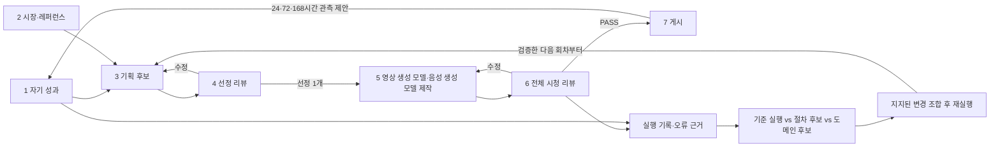

# Dupy GTM loop 설계

2026-10-24 · 상태: 설계 및 스킬 정의. 자동 실행기·정기 일정은 아직 가동하지 않는다. 사용자의 “지금 영상 만들지마” 지시가 유효하다.

## 운영 원칙

목표 컨셉은 제휴쇼핑 쇼츠 제작 자동화다. 실제 제품 사실은 [제품 SoT](../research/dupy-product-sot.md)를 따른다. 새 아이디어를 독창적으로 발명하기보다, 지정 채널의 성과 있는 원본에서 훅·사용 장면·CTA·전개 순서를 추출하고 Dupy의 실제 기능으로 치환한다. 원본의 수익 주장을 Dupy 성과로 바꾸지 않는다.

한 회차에는 대표 레퍼런스, 후보 기획, 승자 1개, 생성 결과, 리뷰, 게시 영수증이 연결된다. 분석과 시장 수집은 병렬로 가능하지만 기획→선정→제작→검수→게시 순서는 유지한다. 각 역할은 별도 작업 문맥으로 실행하고, 오케스트레이터만 회차 상태를 갱신한다.

## 7단계 계약

| 단계 / 담당 | 입력 | 출력 | 완료 조건 / 실패 시 |
|---|---|---|---|
| 1 성과 분석 | 인앱 브라우저의 Instagram·Threads @dupy.app, 이전 게시 URL | own-performance.json, observation.md | 조회/도달/시청지속/저장/공유/댓글/프로필활동 중 실제 보이는 값과 캡처 시간 기록. 누락은 null. 로그인 만료면 대기 |
| 2 시장·레퍼런스 | 지정채널 등록부, TikHub 캐시·기존 원본 | references.json, 원본·전사·장면표 | source URL, 날짜, 수집시각, 지표, 구조, 자산 경로가 연결됨. 수집 실패를 게시물 없음으로 처리하지 않음 |
| 3 기획 | 1+2, 제품 SoT, 브랜드 자산 | concepts.json: 기본 3안 | 각 안에 대표 원본+타임코드, 훅 문장/화면, Dupy 사용 장면, CTA, 변주 매핑, 예상 길이 |
| 4 기획 리뷰 | 후보 전부 + 근거 원본 + 실제 기능 | plan-review.json, selected-plan.json | 가장 나은 1개 선택. 적격 없음이면 기획으로 회귀. 최대2회 수정 후 사람에게 쟁점 보고 |
| 5 콘텐츠 생성 | 선정안, 원본 영상, 전용 인물 사진, 배경 사진, 음성 생성 모델 음성 | production.json, final.mp4, caption.txt | 음성 생성 모델→음성 확인→영상 생성 모델 video reference→실제 제품 데모/자막 조립. job ID와 비용 기록 |
| 6 콘텐츠 리뷰 | 최종 영상 전체+오디오, 채널별 문안·CTA 목적지·계정, 선정안, SoT | content-review.json | 처음부터 끝까지 확인, 첫3초/제품 사실/모델 일관성/립싱크/자막/끝어미/CTA 판정. 문제 있으면 구체 타임코드로5단계 반환 |
| 7 포스팅 | 리뷰 PASS인 파일 해시, 채널별 문안, 대상계정 | publish-receipt.json | 대상계정 재확인→업로드→게시→실제 permalink 재열기. 불확실한 응답이면 재게시하지 않고 조회로 대조 |

## 리뷰 기준

기획 점수는 성과 예측값이 아니라 내부 우선순위다. 기본 배점: 레퍼런스 근거 25, Dupy 실제 기능 적합성 25, 훅/데모/CTA의 연결 25, 제작 가능성 15, 기존 게시물과 구분 10. 중대한 사실 오류나 준비 안 된 핵심 자산은 점수와 관계없이 탈락. 동점이면 근거가 확실하고 비용이 낮은 안을 고른다.

콘텐츠 리뷰는 평균점수로 결함을 상쇄하지 않는다. 잘린 발화, 잘못된 제품 화면, 다른 얼굴, 원본 크리에이터 음성 잔존, 작동하지 않는 CTA, 기획과 다른 주장 중 하나라도 있으면 REVISE. 음성 전사와 영상 리뷰가 충돌하면 UNKNOWN으로 남겨 직접 청취한다. 프레임 샘플만 본 것을 전체 시청이라고 기록하지 않는다. 동일 파일을 제작자가 스스로 통과시키지 않도록 별도 리뷰 역할을 둔다.

## 제작 자산과 공급자

- 전용 인플루언서 사진: 동일 인물 버전을 고정하고 asset ID/hash 기록. 현재 미선정.
- 배경 사진: 기획별 승인된 사진. 현재 미선정.
- 음성 생성 모델: 고정 프로필은 `assets/voices/dupy-female-v1/profile.json`이다. OpenRouter 음성 생성 모델에 denoise된 참고 WAV·전사·연출 지시를 재사용하는 stateless clone이며 voice ID는 보내지 않는다. 선택본은 비교2번(v02). 파일 해시 확인, 누락 시 생성 중지. 음성 생성 모델 직접 API/웹 또는 C/일반여성2로 임의 전환하지 않는다.
- 영상 생성 모델: Higgsfield `video-reference-model`. `video_urls`에 원본의 해당 구간, `image_urls`에 인물·배경, `audio_urls`에 음성 생성 모델 음성을 넣고 역할을 프롬프트로 명시한다. 입력 지원은 문서 확인이며 인물 고정/음성 그대로 재현은 실제 테스트 필요.
- 최소 생성길이는 공식 문서상4초다. ‘첫3초 훅’은 전체 영상의 첫3초 구간 설계이며 무조건3초 요청하지 않는다. 최종 타임라인은 음성을 자르지 않는다.
- 영상 레퍼런스 입력시간도 비용에 반영될 수 있으므로 필요한 구간만 사용한다. 생성 전 회차 예산과 최신 가격을 확인한다. 모델을 임의로 Wan 등으로 바꾸지 않는다.
- 원본은 구도·동작·템포 참조다. 실제 제품 UI는 직접 촬영한 Dupy 화면을 사용한다. 원본 얼굴/음성을 우리 브랜드로 유지하지 않는다.

공식 근거: [영상 생성 모델 API](Higgsfield 문서), [가격 계산](Higgsfield 문서), [음성 생성 모델 TTS](https://docs.음성 생성 모델.audio/api-reference/endpoint/openapi-v1/text-to-speech). 문서 확인일 2026-10-24. 실제 결합 파이프라인은 아직 실행하지 않았다.

## 성과가 다음 회차로 돌아오는 방식

게시 후24/72/168시간 관측을 기본 제안으로 둔다. 일정은 아직 미지정이며 예약 작업을 만들지 않았다. 시점별 스냅샷을 보존해 누적 숫자와 증가량을 구분한다. Instagram과 Threads, 광고와 유기적 게시물, 게시 후 경과시간을 섞어 순위를 만들지 않는다.

자기 성과가 없으면 콜드스타트로 기록하고 시장 레퍼런스로 출발한다. 자기 계정의 조회수0과 데이터 누락은 다르다. 현재 프로필 확인상 Instagram 게시물0개이므로 히스토리로 승자를 추정할 근거가 없다. 랜딩 유입/가입은 추가 계측 전 수익으로 추정하지 않는다.

각 게시물은 reference_id→concept_id→asset_hash→post_url로 이어진다. 다음 회차는 어떤 훅/사용 장면/CTA 조합이 동일 관측창에서 나아졌는지 비교한다. 댓글 키워드 유도 수를 구매 의도로 동일시하지 않는다. 소수 게시물로 인과적 승리를 선언하지 않는다.

## 상태·재시작·실행 범위

`runs/<run_id>/state.json`과 단계별 결과 파일을 둔다. 리뷰에는 검수한 영상/문안의 해시와 대상계정 ID도 저장한다. 최소 상태: stage, status(pending/running/passed/revise/blocked/unknown), input_hashes, output_paths, review_version, attempt_count, provider_request_id, publishing_receipts, next_observation_at. 파일은 임시파일 후 원자적 교체한다. 회차별 잠금으로 중복 실행을 막는다.

상위 입력/파일이 바뀌면 하위 리뷰를 무효화한다. 게시할 영상·문안·계정의 해시가 통과한 리뷰와 달라지면 재검수한다. 유료 요청은 응답이 없어도 자동 재제출하지 않는다. 게시 응답이 불명확하면 계정 피드를 확인하고 상태를 복구한다. 복구 불가 시 UNKNOWN으로 멈춘다.

현재 [config.json](config.json)은 design_only이며 제작·게시를 비활성화했다. 사용자가 루프 실행을 요청하고 자산/예산/대상/범위가 정해지면 state.json.activation에 mode, production_enabled, publishing_enabled, accounts, asset_ids, budget_usd, authorization_evidence를 기록해 그 회차만 활성화한다. 이 activation이 기본 config보다 우선하되 현재 사용자 중지 지시가 최우선이다. 글로벌 기본값을 명시 요청 없이 바꾸지 않는다. 해당 회차에서 리뷰 PASS 후 게시까지 실행한다. 이미 승인한 회차의 게시를 매번 재승인 받도록 만들지 않는다. 사용자의 중지 지시는 즉시 우선한다.

스킬은 단계 수행 지침이지 스케줄러가 아니다. 인앱 브라우저 세션은 로그인 확인됐지만 무인 예약 실행에서 접근 가능한지는 검증하지 않았다. 세션/일정이 준비되기 전 ‘상시 자동 운영 중’이라 하지 않는다.

## 준비 상태

확인됨: 양 채널 @dupy.app 로그인, 제품 SoT, <ref-ig> 릴스19개와 <ref-threads> Threads 본글14개/연결답글8개 자료, API 입력 규격.
미정: 전용 인플루언서 사진, 배경 사진, 회차 예산, 주기·게시량, 추가 추적채널. 현재 레퍼런스 채널 두 채널을 초기 등록부로 둔다.
이전 Wan 테스트는 채택하지 않으며 신규 영상 생성 모델/음성 생성 모델 제작을 시작하지 않는다.

## Harness²에서 가져오는 개선 루프

[원문 분석](../research/harness2-analysis.md)에서 확인한 Propose–Probe–Compose를 기획·리뷰 구간에 먼저 적용한다. 연구 코드 전체를 도입하거나 Google의 공식 지원 서비스로 취급하지 않는다.

기준 스킬 버전과 자료 묶음·모델·평가표를 고정한다. 절차 후보1개와 Dupy 도메인 후보1개를 같은 자료에서 실행해 행동 차이를 비교한다. 지지된 변경만 조합하고 조합판도 다시 실행한다. 근거 없으면 기존 버전 유지. 후보 기획 best1 선정은 이 개선 실험과 별개다.

`runs/<run_id>/artifacts/experiments/<id>/`에 baseline/candidate-a/candidate-b/composed 결과와 변경가설·비교·채택 이유를 저장한다. `workflow/lessons.jsonl`은 증거 있는 교훈이 생긴 뒤에만 생성한다. 같은 회차에서는 스킬/교훈 버전을 고정하고 다음 회차가 기본 스킬에서 필요한 교훈만 가져간다. 콘텐츠 제작/게시를 무작정 반복하는 방식으로 probe하지 않는다. 개선 예산은 초기 제안(기준1+후보2+조합1)이며 아직 실행하지 않았다.

## 실행 범위와 단계 아티팩트

[실행 기록 계약](run-records.md)이 폴더·부분 실행·JSON 기록의 기준이다. 전체7단계 또는 요청한 일부 단계만 선택하며, 기존 입력을 참조해 중간 단계에서 시작할 수 있다. 새 호출은 시간 기반 새 폴더, 동일 호출의 재시도는 새 단계 기록으로 남긴다. 입력·관측·근거 요약·수정·결론·산출물·검증·실패를 저장하며 내부 사고과정 원문을 요구하지 않는다. 기존 state.json은 오케스트레이터 상태용이고, immutable run.json 및 단계 기록이 감사 자료다. 부분 실행은 해당 범위 밖 생성·게시를 활성화하지 않는다.

레퍼런스 분석·변주·실제 편집의 상세 기준은 [정밀 분석과 편집 계약](reference-editing.md)을 따른다. 촬영 원본 전체를 그대로 붙이지 않고 오디오 제거·구간 선택·배속·자막·내레이션 결합을 거친다.
