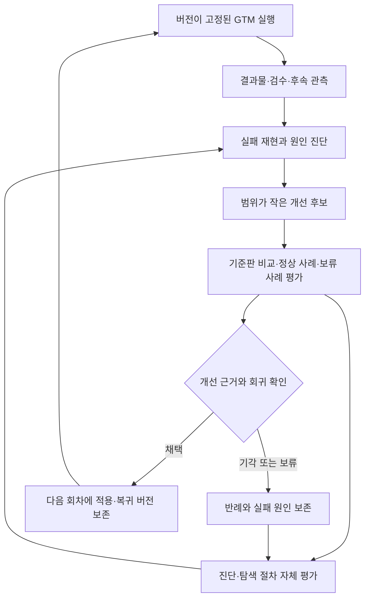

# Self-Improving Harness

2026-11-01 · 실제 운영 기반과 다음 구현을 구분한 설계.

## 목표

콘텐츠를 만든 결과와 그 결과를 만든 실행 방법을 함께 개선한다. 하네스가 다루는 대상은 프롬프트뿐 아니라 입력 근거, 단계 순서, 검수 조건, 부분 수정 범위, 도구 실패 복구다.

현재 기반은 실제 콘텐츠 제작·수정·예약 경험, 단계별 JSON 기록, 부분 실행, 독립 검수 역할과 운영 계약이다. 후보 생성→격리 평가→검증판 등록→자동 승격·복귀를 연결한 엔진은 아직 구현·검증 전이다.

## 이미 수행한 개선: 훅의 생성 방식을 바꾸다

발화형 AI 훅에서 얼굴·립싱크 문제가 반복되자 하네스는 무음 리액션과 자막으로 전환했다. 설명은 실제 제품 데모와 내레이션으로 전달했고, 전환한 포맷의 게시물에서 좋은 반응을 확인했다. [사례 기록](../research/hook-format-transition.md).

이는 실패를 바탕으로 제작 전략을 변경하고 실제 배포 반응까지 회수한 운영 사례다. 아래 설계는 이 경험을 반복 가능한 평가·승격·복귀 체계로 확장하는 방향이다.

## 세 층의 루프

이 그림은 목표 구조다. 화살표 전체가 현재 자동 실행된다는 뜻은 아니다.

### 1. GTM 실행

성과·시장 분석→기획→기획 리뷰→제작→콘텐츠 리뷰→게시의 흐름을 유지한다. 입력·규칙 버전을 고정하고 요청한 단계만 수행한다. 게시·성과 관측·제품 사용은 각각의 증거로 확인한다.

### 2. 실행 방법 개선

실패를 먼저 재현한 뒤 수정할 단계를 특정한다. 기준판과 수정판을 같은 입력과 평가 조건에서 비교하고, 기존 성공 사례도 시험한다. 수정에 사용한 사례와 선택용 검증 사례, 최종 보류 사례를 분리한다. 유사한 원본의 변형이 양쪽에 섞이지 않도록 원본·실행 단위로 나눈다.

후보에는 부모 버전, 변경 파일, 가설, 평가 결과, 반례, 채택 사유와 복귀 버전을 남긴다. 새 후보라는 이유로 운영 버전을 덮어쓰지 않는다. 외부 게시·메시지 발송은 평가를 위해 재실행하지 않는다.

### 3. 개선 방법 개선

진단이 맞았는지, 후보 탐색이 낭비였는지, 검수기가 오류를 통과시켰는지를 평가한다. 개선기의 입력 선택·진단·탐색 절차도 변경 후보가 되지만, 같은 회차의 정답과 합격 기준까지 변경할 수는 없다. 동일 실패 묶음과 예산에서 기존 개선기와 비교하는 것이 완료 조건이다.

## Dupy에 맞는 검증

| 반복된 문제 | 검증할 행동 | 필요한 근거 |
|---|---|---|
| 캡션을 영상 훅으로 분류 | 첫 화면·음성 근거가 없거나 충돌하면 판단 보류 | 원본 구간, 화면 문구, 전사, 분류 근거 |
| 대사와 제품 화면 불일치 | 발화 시점과 입력·클릭·결과 동작 대조 | 발화 타이밍과 편집 타임라인 |
| 음성 덮어쓰기·끝어미 잘림 | 채택한 음성 보존과 실제 발화 끝 확인 | 오디오 트랙·원본 해시·청취 결과 |
| 부분 수정 뒤 전체 PASS | 바뀐 구간과 연결부만 재검수하고 기존 미해결 유지 | 변경 범위·파일 해시·검수 범위 |
| 승인 훅 임의 변경 | 사용자 고정 계약과 제작 입력 대조 | 승인본과 실제 요청의 차이 |

파일·길이·해시 등의 검사는 코드로, 인물·장면 의미·정밀 시청 검수는 미디어 리뷰로 나눈다. 프레임 몇 장을 확인한 것을 전체 재생·립싱크 검증으로 기록하지 않는다. 검사 점수의 개선은 고객 성과 개선과 별개다.

## 경험의 수명

경험은 적용 조건과 근거가 있는 작은 항목으로 저장한다. 상태는 `proposed`, `validated`, `rejected`, `superseded`로 구분하고 반례·대체 항목·검증 버전을 연결한다. 같은 근거를 중복 축적하지 않고, 반증된 규칙은 다음 실행에 전달하지 않는 소비 경로를 구현한다.

이번 정비에서는 기존 L2를 폐기하는 후속 기록을 [교훈 이력](lessons.jsonl)에 추가했다. 이는 문서상 철회이며, 자동 경험 소비·철회 엔진을 검증한 결과는 아니다. 과거 L2는 역사적 판단으로만 읽는다.

사용자 고정 훅·인물·음성·예산·계정·게시 권한은 개선 대상이 아니다. 복귀는 다음 실행의 하네스 버전 복귀이며, 이미 게시한 콘텐츠의 자동 삭제·재발행을 의미하지 않는다.

## 연구에서 가져온 설계

OpenAlex를 통해 문헌을 선별하고 원문 방법을 검토했다. 아래는 Dupy용 적용 설계이며 원논문의 완전 재현이나 Dupy에서의 성능 보장이 아니다.

| 연구 | 적용할 원리 |
|---|---|
| [Harness²](https://arxiv.org/abs/2610.14224) | 실행과 개선 분리, 비교한 변경을 조합한 뒤 재시험 |
| [VERSE](https://arxiv.org/abs/2610.02616) | 실패 재현과 수정 검증, 회귀 감사 |
| [Meta-Harness](https://arxiv.org/abs/2603.28052) | 요약뿐 아니라 원본 실행 흔적·후보·평가를 선택적으로 조회 |
| [ACE](https://arxiv.org/abs/2510.04618) | 경험을 항목별로 갱신하고 모순·중복을 관리 |
| [RSIFlow](https://arxiv.org/abs/2610.21791) | 병목에 따라 수정할 구성요소와 개선 절차 선택 |
| [Batched GEPA](https://arxiv.org/abs/2610.36774) | 저비용 후보를 작은 평가 배치에서 먼저 선별 |

## 다음 구현의 완료 조건

1. 원본 실패와 기준판의 잘못된 행동을 다시 재현한다.
2. 수정판이 해당 실패를 해결하고 정상 사례를 보존하는지 같은 조건에서 비교한다.
3. 수정에 사용하지 않은 사례에서 평가하고, 근거 부족·회귀 후보를 기각한다.
4. 채택판을 다음 실행에 적용하고 실패 시 이전 검증판으로 돌아가는 것을 확인한다.
5. 익명화한 재현 예제와 실제 운영 증거를 분리해 검토할 수 있게 제공한다.

개인 미디어와 원시 응답은 공개하지 않는다. 공개 저장소에는 구조·규칙·익명화한 평가 결과를, 비공개 실행 폴더에는 실제 근거와 산출물을 둔다. 최초 7일의 운영 결과와 이후 설계·구현을 날짜로 구분한다.
